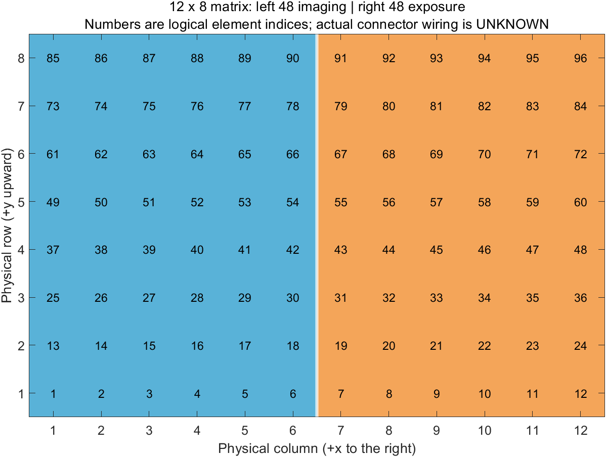

# 2026-10-12撤回实物适用性

用户已纠正：实际探头与原始64阵元线性驱动相符。本文12×8布局是已撤回的硬件假设，保留作synthetic历史记录；当前驱动见[64线阵说明](../../verasonics/dual_mode/README.md)，实物证据见[硬件研究](sonic_eyes_hardware_2026-10-12.md)。

# 12×8矩形阵列及固定左右分区修正

2026-10-09，用户确认实际设计是**单个12列×8行矩形阵列，共96元；左6×8成像，右6×8固化**。此前将不匹配的P9-4ULts 64元线阵例程当作硬件基线，是建模前提错误。2026-10-08的85项测试检验了那个前提下的代码一致性，不能作为适合本探头的证据；旧序列与报告被本次修正取代。

## 已实现

- 默认探头改为type2的96点二维阵面，保留完整x/y/z和零法向角。矩阵排列与P0几何模块一致：x方向编号变化最快。
- 以物理x坐标排序划出左六列/右六列，不以连接器号或连续1–48划分。生成互斥、全覆盖的48/48掩码。成像TX与Receive只使用左半阵，照射TX只使用右半阵；自定义TX权重不得越过固定分区。
- 照射使用显式三维FocalPt和等到达时间延时，支持非零y焦点。成像改为左子孔径平面波复合，使用三维PData、XZ切片及intensity3D显示；移除默认线阵SectorFT及负虚拟焦距假设。
- 接收范围由完整三维网格角点与活动成像阵元计算；保留有限事件、TPC、等待、缓冲帧数约束和导出。
- 新输出目录为`results/verasonics_matrix_partition`，前缀`ICE_MatrixPartition_`，报告schema_version=2；增加逐阵元映射CSV及物理分区PNG。旧线阵输出保留作历史记录并明确标为superseded。

入口：[SetUpICE_ImagingCuring.m](../../verasonics/dual_mode/SetUpICE_ImagingCuring.m)；参数：[default_config.m](../../verasonics/dual_mode/+icevs/default_config.m)；说明：[README](../../verasonics/dual_mode/README.md)。

## 已验证

MATLAB R2024b Update2，全项目**91/91测试通过，0失败、0未完成**；驱动相关31项包括历史线阵数学测试、事件测试及新的矩形分区验收。16个MATLAB文件Code Analyzer为0条消息。执行命令：`startup_ice; r=run_tests; verify_verasonics_dual_mode;`，没有调用VSX。

本次先修改验收测试并确认旧实现失败（type0/64元、无物理分区及不能处理非零y目标），再实施修正。新增矩阵专门检查覆盖：12×8的行列/坐标、x最快排列、实际坐标平移及元素列表重排、非顺序ConnectorES、17个TX与厂商二维computeTXDelays数学函数对照、额外俯仰平面波对照、3D网格接收界限及异常几何拒绝。成像/照射跨区权重被拒绝。

证据：[本轮测试快照](../../results/verasonics_matrix_partition/test_results.csv)、[代码分析](../../results/verasonics_matrix_partition/code_analysis.json)、[三模式事件汇总](../../results/verasonics_matrix_partition/mode_summary.csv)、[逐阵元物理分区及假设接线](../../results/verasonics_matrix_partition/ICE_MatrixPartition_interleaved_elements.csv)。

默认交替模式933个事件、450次左半阵接收、300个右半阵照射脉冲。每组合周期调度下界41008.4 us，30周期及初始等待共1235252 us；不计实际DMA/重建开销，不是实测帧率或能量。

## 数据来源、数值模型与限制

| 项目 | 来源与状态 |
|---|---|
| 12×8拓扑、左成像右固化 | 用户确认，未声称实验室接线已独立测量 |
| pitch=[0.3,0.3] mm，width=height=0.25 mm | 借用P0矩形示例，synthetic，不是从P9阵元尺寸推导 |
| 频率/带宽、阻抗、connType、供电上限 | 借用不匹配的旧例程数值用于离线结构，assumed，不证明适合实物 |
| ConnectorES=1:96 | synthetic离线映射，实际引脚/通道对应unknown |
| 驱动波形、焦点、PRI及切换/恢复等待 | assumed；电声与材料标定unknown |

求解范围为均匀介质几何延时与离线事件编排；未运行声场、热/血流、材料反应或固化求解器。矩形单元的宽高保存在配置，VSX的101点轴对称ElementSens采用assumed的cos近似，不能代表完整二维矩形方向性。XZ切片结构生成不等于实际成像质量通过，不声称完成三维容积成像。

物理分区不意味着同时收发：本版仍交替工作。隔离、串扰、接收饱和、恢复时间、采样/TW量化、最终缓冲、profile5配置及许可均需后续验证。未测参数无法推出声压、温升、固化或临床安全结论。本版拒绝simulate_mode=0，默认冻结且只离线导出。

原P0仿真及其他线程准备的历史诊断/独立仿真文件不在本次改写范围；不能因驱动修正便把它们的旧结果视为本探头结果。

## 硬件依据

AGENTS指定的D00163 Rev.K §13.1第107–110页分别给出type2、ElementPos、ConnectorES及轴对称ElementSens约定；第121页给出NS200BW范围和采样量化；A101规定缓冲帧数为1或偶数；A107/A109说明noop/stop及TPC切换；A171说明延时单位与45.5us上限。D00108 Rev.L §1.4描述功率选配，不能据此认定实机已经配置。D00107 Rev.K、D00109 Rev.D保留作系统操作/首次设置依据，本次未执行其硬件操作。

随包`SetUpM3dVFlash.m`用于核对type2的PData.Size=[Ny,Nx,Nz]、Slice和intensity3D显示，`computeTXDelays.m`用于纯数学对照；未继承其1024阵元、HVMux或供电参数。原XJD脚本和厂商工具不修改。
