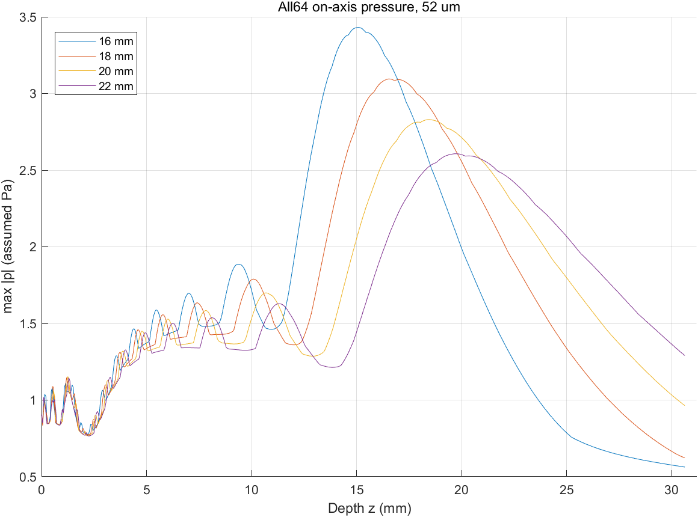
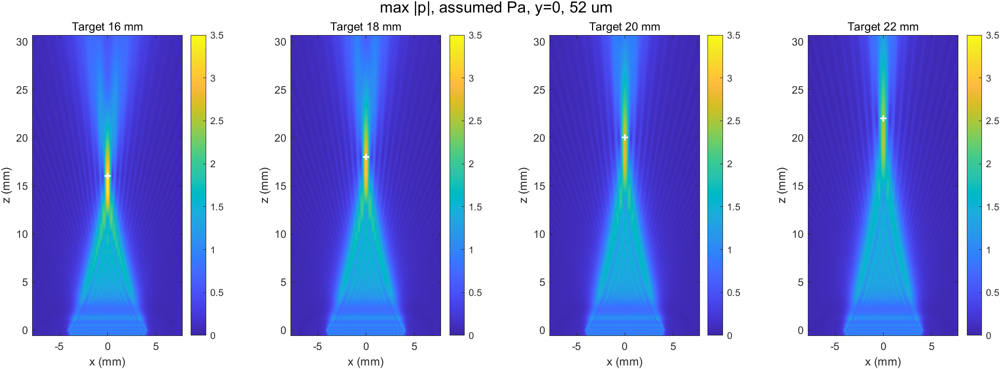

# 全64元在固定20 mm目标处的已有声场分析

日期：2026-11-19。仅回读已有结果，未启动传播、MATLAB、VSX或硬件。

## 当前问题与比较口径

继续以全64元、距阵面20 mm为研究重点，当前不把缩窄焦区作为优先目标。必须分开回答：压力最大值是否位于20 mm，以及20 mm处是否仍有较高压力。这两个问题不能仅用峰位偏移合并判断。

此前[焦深对照报告](focus_depth_comparison_2026-11-14.md)的 `target_pressure_assumed_pa` 随每组设定在16、18、20、22 mm取值，不能直接用这一列比较同一个20 mm目标。本次重新读取四份 `focus*_axial_dx52.csv`，统一选取最接近20 mm的轴上格点，四组均为20.020 mm；不做峰位对齐或插值。

源数据及新增派生表均位于 `independent_simulation/results/focus_depth_2026-11-14/`。新增[固定目标比较表](../results/focus_depth_2026-11-14/fixed_target20_comparison_20261119.csv)记录每份输入CSV的SHA-256、未舍入数值和归一化比例。

## 固定位置的结果

| 几何设定焦深 mm | 既有前向压力峰深 mm | 峰深减20 mm | 20.020 mm处压力 assumed Pa | 该点/本组峰压 | 该点相对本组峰压 dB | 该点压力/原20 mm设定 |
|---:|---:|---:|---:|---:|---:|---:|
| 16 | 15.080 | −4.920 | 1.983126 | 57.80% | −4.761 | 73.19% |
| 18 | 16.536 | −3.464 | 2.550647 | 82.42% | −1.679 | 94.14% |
| 20 | 18.460 | −1.540 | 2.709499 | 95.75% | −0.377 | 100.00% |
| 22 | 19.708 | −0.292 | 2.600433 | 99.75% | −0.022 | 95.97% |

压力为单发 `max_t |p|`，不是同一时刻的空间快照。dB定义为 `20 log10(p(20.020 mm)/本组轴上z≥2 mm峰压)`。本轮重新搜索CSV的轴向峰，核对其深度及幅值与既有三维汇总一致；原三维报告记录这四组前向峰均在x=y=0。本轮没有回读三维原始场，未重新验证离轴极值。

以上沿用既有图片；固定20 mm处的新比较以本表和新增CSV为准，图片中的设定点仍随组改变。

## 对当前64元方案的含义

1. **20 mm几何设定保留为当前比较基线。** 虽然其压力峰提前1.540 mm，固定目标采样点仍达到本组峰压的95.75%，且在本次四个离散设定中，该点压力最高。峰位提前本身不说明20 mm处压力已经显著衰减；这也不等于已经达到固化要求。
2. **22 mm设定是峰位更靠近20 mm的对照。** 它将峰位偏差的绝对值从1.540 mm缩小到0.292 mm，但固定目标采样点压力相对原设定下降4.0253%。这一比较来自同源、同网格模型，不是等实测总声功率比较。不能仅因峰位更接近目标就宣布它更优，也不能据此修改实物驱动。
3. **是否需要峰位补偿取决于验收目标。** 如果要求最高压力位置接近20 mm，22 mm对照更接近；如果现阶段关注该固定点的压力大小，这四个已算设定中原20 mm组更高。尚无用户给定的允许峰位误差、目标区域范围、固化质量或处理时间阈值，因此暂不判定合格，也不推定连续焦深中的最优值。

后续分析继续围绕全64元基线，优先区分固定目标区域表现和全域目标外暴露；多焦及分批照射仍作为待选方向。本轮不据四个离散点外推精确补偿焦深，不自动恢复传播计算。

## 验证、模型与限制

- 本轮以PowerShell读取四份轴向CSV，按到20 mm的距离选择最近格点，重算z≥2 mm轴向最大值及比例；与既有 `comparison_dx52.csv` 核对峰深误差≤1e−9 mm、峰压误差≤1e−6 assumed Pa。另以Python独立回读复核派生CSV、输入哈希及四组排序。实际执行结果见本次Git提交正文。
- 沿用既有52 μm网格、每元1 Pa assumed源、全64元同幅、均匀线性无损介质（声速1540 m/s、密度1000 kg/m³）、平面矩形BLI源及无真实俯仰透镜模型。既有求解器二进制哈希和时间步见原焦深报告；本轮未调用求解器，未改变模型、波形或驱动。
- 仅有一档焦深比较网格；源面/近源的原生峰仍有网格敏感性。轴向CSV不能重新验证三维旁瓣、目标平面覆盖、目标外暴露或全域收敛。
- 固定20 mm的Qp未从原始场重新提取，不能用峰压平方代替 `∫p²dt`；不同位置的Qp也不能混作同一位置比较。压力单位均为assumed，未建立实际声功率、电功率、温升、材料固化或临床安全结论。
- 本轮只使用Git中的小型曲线和表图；三维MAT/HDF5、MATLAB/k-Wave/CUDA及指定四份硬件手册的本机路径不保证跨电脑可用。本报告没有新增硬件能力或操作结论。
