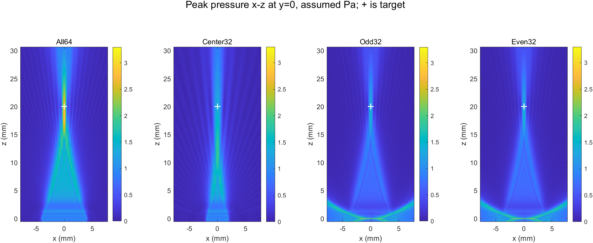
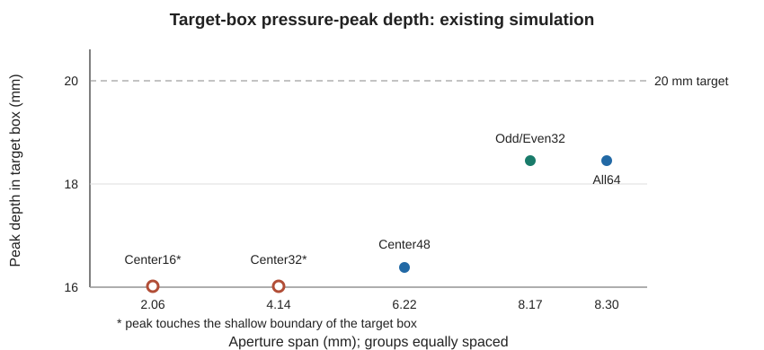

# 纯照射声场：已有结果与文献图表对照

整理日期：2026-11-13。**本次只整理已完成的计算与公开文献，没有重新运行仿真或操作硬件。** 先前检索记录见 [线阵近场](linear_array_nearfield_literature_2026-11-13.md) 和 [声场现象](curing_acoustic_literature_2026-11-13.md)；本报告统一问题、数据和图表口径。

项目所有数据来自均匀、线性、无损介质下的一发假设波形；每个活动阵元假设相同激励，不是等总功率。阵面为平面矩形，未建真实俯仰透镜。压力未标定，不能用于推断实际功率、温升或安全性。目标 `[0,0,20] mm` 是延时设计目标，不自动等于声压最大点；目标盒为 x/y ±2 mm、z 16–24 mm。近场区域以 z≥2 mm 为前向检索下限。

## 1. 设定 20 mm，压力峰是否一定在 20 mm？

**我们的结果。** 52 μm 网格下，全64目标盒峰在18.460 mm，比目标浅1.540 mm；z=20.020 mm 处压力是目标盒峰约95.75%。奇、偶32的目标盒峰均在18.460 mm，但其前向域更高的峰在近源侧方，不能把盒内峰说成全域峰。[数据来源](curing_sparse_comparison_2026-11-13.md)。

**图1：**本项目已有结果；`max_t|p|` 是每个点在时间上的最大绝对声压，并非同一时刻快照。色标是未标定假设压力。完整设置及域范围见原报告。

**文献及图。** [Marhenke 等，2019，图6](https://www.mdpi.com/1424-8220/19/4/863)：5 MHz、128元医疗线阵，设计焦深32 mm，水听器在其中心截面观察到最大压力位于32 mm。文中图6对照水听器测量与重建，最大偏差为其最大压力的7.29%。作者坐标中传播方向是 y，与我们的 z 不同。

**图2：**Marhenke 等，*Sensors* 19, 863 (2019)，图6；[原文及图注](https://www.mdpi.com/1424-8220/19/4/863)，CC BY 4.0。它是水听器测量与重建，图1是我们的模型；颜色、坐标、探头及工况不同，不可按颜色比较绝对声压。

| 对照项 | 我们：All64 | Marhenke 等 |
|---|---|---|
| 手段 | 假设源三维声场 | 实物线阵水听器测量 |
| 设定焦深 | 20 mm | 32 mm |
| 目标附近压力峰深 | 18.460 mm | 32 mm |
| 可得出的判断 | 本工况目标盒内峰偏浅 | 另一器件工况下测得峰在设定深度 |

**判断。** 几何焦点和压力最大值需要分别报告；两者可能相近，也可能不同。上述论文不能量化验证我们的1.540 mm偏移。焦点形态还可参考 [Williams 等图3](https://pmc.ncbi.nlm.nih.gov/articles/PMC10712801/)，其64元线阵在44、50、56 mm设定下给出轴向实测与模拟剖面；该探头有固定俯仰透镜，与我们模型不同。

## 2. 变化的是阵元数，还是孔径和排列？

**我们的结果。** 图3按已有报告数据绘制。连续组的阵元数和跨度一起变化；奇偶组各32元、跨度8.17 mm，与全64的8.30 mm相近。奇偶与全64的目标盒内峰相同，但奇偶的全前向域峰不在目标盒。

**图3：**项目原数据重绘，横轴各组等距排列并标注实际跨度，并非线性数值轴；中央32和16的目标盒峰均触及浅侧边界16.016 mm，不能解释成完整焦点。虚线为20 mm设计目标。图中圆点是目标盒最大值，不是所有组的前向全域峰。原始结果见 [四版](curing_four_variant_comparison_2026-11-12.md)、[奇偶组](curing_sparse_comparison_2026-11-13.md)。

| 组别 | 活动阵元数 | 外缘跨度 mm | 活动间距 mm | 目标盒峰深 mm |
|---|---:|---:|---:|---:|
| 全64 | 64 | 8.30 | 0.13 | 18.460 |
| 中央48 | 48 | 6.22 | 0.13 | 16.380 |
| 中央32 | 32 | 4.14 | 0.13 | 16.016，触及盒边界 |
| 中央16 | 16 | 2.06 | 0.13 | 16.016，触及盒边界 |
| 奇／偶32 | 各32 | 各8.17 | 0.26 | 各18.460 |

**文献对照。** [Kashani 等图13](https://pmc.ncbi.nlm.nih.gov/articles/PMC9131469/#F13) 给出另一支1.1 MHz、16元线阵在20 mm设定焦距的水听器测量和模拟。其正向发射实测轴向、横向半功率宽度分别18.8、2 mm，峰值0.83 MPa；这是该器件和测量条件下的实测值，不能与本项目未标定的 assumed Pa 比较，也不能直接与我们声压幅值 −6 dB 宽度比较。

[Pajek 和 Hynynen 图5、10及表II](https://pmc.ncbi.nlm.nih.gov/articles/PMC3855063/) 是1.5 MHz半球经颅阵列的模拟：几何焦点处 100%、10%、1%填充的轴向焦区宽度分别约1.40、1.41、1.39 cm，而稀疏时相对旁瓣一般增大。它支持“相近焦区宽度与不同填充可同时存在”，但不是相同结构的线阵实测。

**判断。** 本项目观察与“跨度、排列和对称性共同影响场形”相符，不能推出阵元数越多必然聚焦越远，也不能单独证明跨度是唯一原因。奇偶与全64在本线性对称模型中心面的时域压力近似分别为全64的一半，峰深一致有对称性解释；实际探头不一定满足理想幅相一致。

## 3. 近场高值与目标外声场有文献支持吗？

**我们的结果。** 52 μm 下，奇／偶32在目标盒外且 z≥2 mm 的压力峰分别在 x≈−6.344／+6.344 mm、z=2.028 mm，约1.809 assumed Pa。该点是所设搜索范围的浅侧首层；不证明它是独立近场焦点或已确认栅瓣，也无法排除域外更高峰。更靠近源面的峰有网格敏感性。

**文献图。** [Williams 等图3(a)](https://pmc.ncbi.nlm.nih.gov/articles/PMC10712801/#F3) 展示一维线阵的轴向压力剖面，测量与模型均可见焦前、焦后的声场；该阵列有固定俯仰透镜。其作者指出矩形源轴向低谷不一定像圆对称源那样接近零。它支持检查焦点之外的分布，不证明我们的离轴峰位置或生物效应。Pajek 等图5与图10则展示稀疏阵列的目标外高值和旁瓣变化，但其为半球经颅模型，不是相近线阵。

**判断。** 已有文献支持“焦外可存在明显声场”，尚未找到与本探头几何、奇偶排布、20 mm设定以及0–2 mm近源测量同时匹配的实物研究。不能据此声称近源高值已获实测确认，或断言孔径越大所有目标外压力越低。

## 4. 阵元的网格表示是否会造成数值误差？

**我们的设置。** 本次声场使用 [kWaveArray 的矩形阵元带限插值](https://www.k-wave.org/documentation/kWaveArray.php)，0.11×2.02 mm 阵元不是按面积比例简单涂到网格；参数 `BLITolerance=0.05`、`UpsamplingRate=10` 控制源表示。5%是截断阈值，不是误差上限；上采样不等于全域传播网格加密。[代码](../+iceind/curing_bli_prepare.m)。

| 单阵元 6 MHz、75° 源谱幅值诊断 | 65 μm | 52 μm |
|---|---:|---:|
| BLI截断0.05，上采样10 | 0.9855% | 0.5958% |
| BLI截断0.05，上采样20 | 2.4604% | 0.1928% |

数值源自 [原始CSV](../results/curing_field_2026-11-10/bli_probe/bli_source_representation.csv)，仅为该方向及频率的**谱幅值相对差**，不是完整声场误差。原先环境报告将其称为“复谱误差”，与脚本的幅值口径不符，应以此更正为准；小域内阈值0.01的BLI支持触及边界，不能单独以数值大小判优。

项目奇偶组源面Qp峰65→52 μm变化+8.59%；All64近源细网格32.5→26 μm时源面原生Qp峰变化+5.38%。换网格同时改变离散源、传播和峰值采样点，不能单独归因给阵元宽度或BLI，也不能靠共同点误差小证明原生峰收敛。

**文献图。** [Wise 等（2019）图11–12，原文PDF](https://discovery.ucl.ac.uk/id/eprint/10079376/8/Cox_Representing%20arbitrary%20acoustic%20source%20and%20sensor%20distributions%20in%20Fourier%20collocation%20methods_VoR.pdf)：作者针对聚焦碗比较数值解与解析解，并展示不同网格/截断参数的误差。其图11中近场误差较大，参考解排除距碗口约两个波长的区域；几何、频率与我们的源面Qp不同。文献支持进行分区与参数收敛检查，不给出本模型的误差值。

**后续方法。** 若恢复研究，可先对同一连续矩形、同一自由空间加性源的同点波形与独立格林函数积分作对照，再分别改变 BLI 截断、积分采样和传播网格。COMSOL 可通过局部贴体网格表示几何边缘，但要对齐源物理定义、开放边界、脉冲及观测位置；其自身也需网格和时间步收敛，不能直接替代实物标定。

## 证据结论和未完成项

目前证据支持：设计焦深与峰深应分开，稀疏排布可保留部分焦区形态而改变目标外场，阵元源数值表示和近源峰需要收敛检查。当前**尚无**与本探头和奇偶32配置相同的近场实测；既有文献不能证明具体焦深误差、绝对压力、温升或固化效果。文章图2为公开许可原图链接，图1、3为项目结果；条件不同的图只作现象对照，不合并色标或数字。
