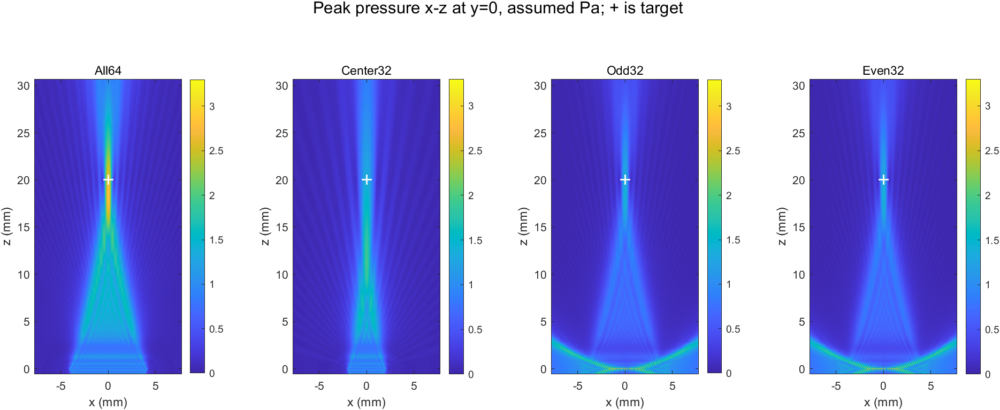

# 相近线阵声场研究：仿真建模方法和验证对照

**图文版：**按用户要求将已取得的论文原图直接附在 [论文原图与本项目对照](linear_array_paper_figures_comparison_2026-11-14.md)，逐图解释硬件、算法及结果；未取得的原图在图文版中明确列出。

日期：2026-11-14。比较对象为本项目既有假设模型与五篇公开研究，重点是**阵元如何表示、声场如何求解、模型怎样核验**。本次未新增仿真或实物测试。结论面向研究方法选择，论文的探头和激励不等于 Sonic Eyes 10F。

## 对照基础：我们的模型

| 项目 | 已完成设置 |
|---|---|
| 对象 | 从离线导出的 MAT 读取活动阵元及 TX 延时；全64、中央48/32/16，以及物理奇／偶32 |
| 几何和声源 | 平面矩形 0.11×2.02 mm、中心间距0.13 mm；`kWaveArray` 截断 sinc 带限插值将各矩形分布到网格，`source.p_mode='additive'`；每活动元同一 assumed 波形幅值，不按阵元数归一化 |
| 传播 | k-Wave 1.4.1 接口及社区 CUDA 求解程序，三维、时域、线性，均匀无损介质；c=1540 m/s、ρ=1000 kg/m³，未建真实俯仰透镜 |
| 信号和数值 | 由驱动6 MHz、20周期构建并经模型滤波；正式对照65/52 μm网格，CFL 0.2，PML 1.04 mm，单发；活动元延时指向20 mm |
| 记录与核验 | 全域各点 `max_t|p|`、RMS推算 `Qp=∫p²dt`；对比两档网格、少量更细近源诊断，以及导出与 GPU 输入输出一致性。没有本探头水听器标定 |

设置和实际运行详见 [四版模型](curing_four_variant_comparison_2026-11-12.md)、[奇偶对照](curing_sparse_comparison_2026-11-13.md)、[阵元源代码](../+iceind/curing_bli_prepare.m)。网格不是精度的充分证明；奇偶组源面Qp原生峰在65→52 μm变化+8.59%，All64在32.5→26 μm变化+5.38%。assumed 1 Pa是输入参考，不是标定的实际阵面声压。

**图1：**项目中52 μm声场；每点各自的 `max_t|p|`，不是同一时刻快照。下面的论文原图使用不同探头、归一化和测量方式，应对照其图注阅读。

## 研究一：类似线阵，k-Wave 与 COMSOL 分工

**待比较的问题：**同样使用三维 k-Wave 时，阵元、介质及验证方式有哪些区别？COMSOL 用在哪个环节？

**论文：[Kashani、Ilham、Kiani，2022](https://pmc.ncbi.nlm.nih.gov/articles/PMC9131469/)，图3、4、13。** 研究无线供能，实验阵列为16元、约1.1 MHz、设焦20 mm。论文明确采用两套工具：

- **k-Wave**求解阵列传播和几何优化。阵元通过声源掩码中的均匀分布点源表示；三维网格 660×512×256、61 μm，记录两个相互垂直平面的压力；约34 μs、2751步、约12.3 ns/步，PML约0.64 mm。优化模型包括约0.9 mm Sylgard 涂层及其后的软组织，声速分别1030/1540 m/s、密度1050/1060 kg/m³，设有声衰减。
- **COMSOL**用于接收器几何及频率优化、阵元厚度和谐振分析。接收器优化阶段用天然聚焦圆片近似发射源，不能误说其图13整支线阵的传播是 COMSOL 计算。作者指出高频大阵列 COMSOL 模型的计算成本较高。
- **核验：**图13是水中波束的模拟／水听器对照，对应水的 c=1482.3 m/s、ρ=1000 kg/m³ 与0.002 dB/(MHz·cm) 损失，与上面用于优化的涂层／组织设置不同。0°时轴向／横向半功率宽度模拟20／2 mm、实测18.8／2 mm。论文还有偏转和鸡肉组织条件下的对照。

| 维度 | 我们 | Kashani 等 |
|---|---|---|
| 阵元映射 | 矩形的BLI分布权重 | 声源掩码内均匀分布点源；本文摘取部分未明确其使用BLI |
| 媒质 | 均匀、无损、无透镜 | 优化时涂层+组织并计入衰减；图13水中模拟与实测 |
| 网格 | 65/52 μm；0.11 mm宽约1.69/2.12个网格间距 | 61 μm；不能仅凭网格接近就判断同等误差，波长、阵元尺寸与源表示不同 |
| 输出/归一化 | 每元相同 assumed 声源；目标点、区域峰和Qp | 文章优化采用按阵元数量和面积归一化的压力代理；图13按参考压力归一化 |
| 实验对照 | 尚无本探头实测 | 水听器扫描、阵元阻抗及部分接收器实验 |

**原图：**[图3：计算网格和传感面](https://pmc.ncbi.nlm.nih.gov/articles/PMC9131469/#F3)；[图4：k-Wave／COMSOL分工流程](https://pmc.ncbi.nlm.nih.gov/articles/PMC9131469/#F4)；[图13：模拟与水听器声束](https://pmc.ncbi.nlm.nih.gov/articles/PMC9131469/#F13)。图13的半功率宽度与本项目声压幅值−6 dB宽度不同，不能直接比较数值；实测峰值亦不能和我们的 assumed Pa比较。

**判断：**同一软件可以服务不同物理问题。论文将阵列传播与压电／电路问题分开建模，而且改变比较场景时同步改变介质参数；我们当前只实现假设声源的传播。该文未提供可直接用来验证我们0.11 mm阵元BLI误差的收敛数据。

### 补充：同团队32元 k-Wave 算例及网格尺度

[Kashani 和 Kiani，2023](https://pmc.ncbi.nlm.nih.gov/articles/PMC10664043/) 图2、7、8：使用 `kWaveTransducer` 和 `kspaceFirstOrder3D`，设计为32元、1 MHz、30 mm设焦，360×550×300 网格、间距125 μm；约0.5 mm的Sylgard层后为组织。实际制造阵列的工作频率约0.94 MHz，阵元宽也与设计不同。水槽扫描中论文报告轴／横向半功率宽度实测10.1／1.35 mm，模拟9／2.5 mm；作者认为有较好一致性，但横向数值仍相差1.15 mm，不能忽略，更不能确定差异单由网格造成。

在各自**假设组织声速1540 m/s和中心频率**下，1 MHz／125 μm约12.3个点每波长；本项目6 MHz／52 μm约4.94个点每波长。前者更细是相对波长的采样密度，**不是**两项结果精度的直接排名；阵元大小、源、介质及频带都不同，也不证明任一算例已收敛。论文图2给出类名，不能据此确认其与本项目使用相同源模式或BLI。它是更细网格和水听器验证如何报告的例子。

## 研究二：约6 MHz、64元线阵，MUST 与水听器

**待比较的问题：**有没有结构和频率更相近的线阵，采用不同求解方法并给出实验声场图？

**论文：[Chen 等，2022](https://spj.science.org/doi/10.34133/2022/9871098)，图3–5。** 这是一支透明64元线阵，约6 MHz，中心16元发射、15 mm设焦，分别研究0°、−10°和+10°。作者用 **MUST** 生成波束轮廓，并以水听器扫描相同设定的发射场；图5上排模拟、下排实测。阵元间距0.3 mm，高5 mm，透明换能器材料及结构与我们不同。图5所示实验量为归一化压力、dB显示。

论文还使用 **PiezoCAD** 模拟单阵元脉冲回波和电阻抗，并与测量比较；这和图5的MUST发射声场是两个模型环节，不能把PiezoCAD的电声器件结果当作图5传播求解器。就本次核查可见原文，图5的计算观察点、源离散、介质、具体MUST函数、各阵元幅相和透镜输入细节未完整确认，记为**未核实**。

**图表对照：**[论文图5：MUST模拟与水听器实测](https://spj.science.org/doi/10.34133/2022/9871098)；对照本报告图1。论文观察到0°无明显栅瓣，而±10°出现较强栅瓣；这是其器件和偏转条件的结果，不等于我们奇偶组选元的浅层离轴高值已被识别为栅瓣。

**判断：**这是当前最接近我们频率和线阵结构的实验对照之一。它演示了先用独立波束模型预测，再用水听器按相同选元、焦深、转角扫描。不能根据图像相似就宣称两种模型对源面0–2 mm误差相同；论文图5覆盖范围和本项目源面诊断并不相同。

## 研究三：真实源幅相与俯仰透镜如何进入模型？

**待比较的问题：**假设所有元激励一致、没有透镜，与真实设备的声源有什么差别？

**论文：[Williams 等，2023](https://pmc.ncbi.nlm.nih.gov/articles/PMC10712801/)，§II.C/E、图3–5。** 64元、约1.071 MHz线阵，实物通过圆柱硅胶透镜提供固定俯仰聚焦，阵元电子延时控制方位聚焦。作者在设计阶段假设矩形阵元表面均匀振速，并用圆柱曲率描述俯仰聚焦。

实物阶段，作者用水听器扫描获得声全息面，校正水听器指向性和坐标偏差，经 Rayleigh 积分及角谱处理反传得到阵面复压力；随后以重建的源边界进行传播模拟。论文的非线性模型采用单向 Westervelt 推进，包含衍射、非线性和热黏吸收；这不等同我们使用的线性、均匀、无损 k-Wave 设置，也不将反向散射作为同一机制处理。

**原图与验证：**[图3：设计阶段线性声束与水听器剖面](https://pmc.ncbi.nlm.nih.gov/articles/PMC10712801/#F3)；[图4：由全息测量重建的阵面幅相](https://pmc.ncbi.nlm.nih.gov/articles/PMC10712801/#F4)；[图5：全息边界下的非线性波形与实测](https://pmc.ncbi.nlm.nih.gov/articles/PMC10712801/#F5)。论文报告特定线性条件下，利用重建边界所得波束峰值与实测差小于3%；该数字不是我们的模型误差，也不能用于图3所有理想设计算例。

**判断：**论文有真实源幅相和实际透镜信息；我们使用相同假设阵元波形且无真实透镜，因而尤其不能据此把模型的俯仰焦宽当作实测值。它还说明“模型用实测源边界”与“用水听器独立测场核验”是两个不同环节。

## 研究四：Field II 及单阵元测量合成阵列

**待比较的问题：**不使用三维体网格，还能怎样研究线阵发射声场？

**论文：[Karunakaran 和 Oelze，2013](https://pmc.ncbi.nlm.nih.gov/articles/PMC3674191/)，§2、图3–7。** 作者用 **Field II** 模拟不同波形和稀疏阵列栅瓣，并在脱气水中用水听器测量5 MHz矩形单阵元的场，再对测量场进行空间平移、延时、叠加以合成九元阵列。论文实验合成间距为2.25 mm；摘要中的1.25 mm与该文实验描述有区别，比较时需区分具体算例，不能混用。

**原图：**[文章图3：单阵元扫描平面；图6–7：Field II 模拟；图10–11：测量信号合成结果](https://pmc.ncbi.nlm.nih.gov/articles/PMC3674191/)。Field II模型使用阵元尺寸、曲率及脉冲响应；文中比较的时间平均声强与本项目单发Qp或峰值声压不是相同指标。合成场不是九元阵列同时工作的直接测量，也不能完整反映真实阵列逐元差异和相互作用。

**判断：**Field II 的空间脉冲响应法可作为线性、均匀介质下的独立方法；但实际实现仍有阵元子分割、近场近似和时间采样问题，需要核验。若日后用于交叉对比，必须对齐声源物理定义、边界、波形、观察坐标和归一化，不可直接将不同软件输出的绝对压力视为同一物理量。

## 可采取的研究启发与未完成项

1. **同问题、同尺度比方法。** 仓库已有 [历史单频矩形源轴线积分](singlepoint_validation_2026-10-22.md)，但它不是本次BLI宽带、近源三维模型的同条件完整对照。以后可在相同源物理定义与共同观察点比较BLI和适用的连续源积分，记录时域波形、轴向／横向剖面，再考虑整个阵列。
2. **把传播与换能器本体分开。** k-Wave 可研究给定声源下传播；压电厚度、谐振、电阻抗和透镜需要其材料／结构参数及独立建模或测量。不能从本文推定 COMSOL 自动解决未知参数。
3. **分级核验。** 内部回读和网格敏感性只验证数值实现和稳定程度；论文中的水听器是与实物比较。未来若开展实测，应明确测量窗口、探头空间平均、激励和对准误差。
4. **图表和结论边界。** 我们输出单发 `Qp`；文献半功率宽度、模拟归一化图、接收电功率和实测压力不是相同指标。没有本探头标定，暂不作实际功率、温升或固化判断。
