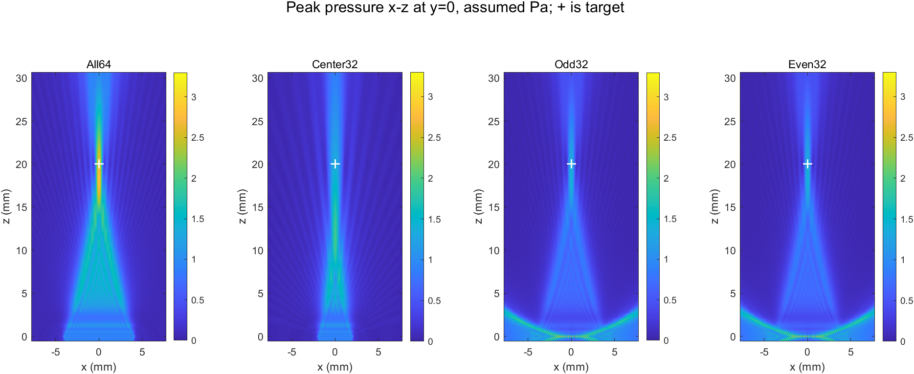
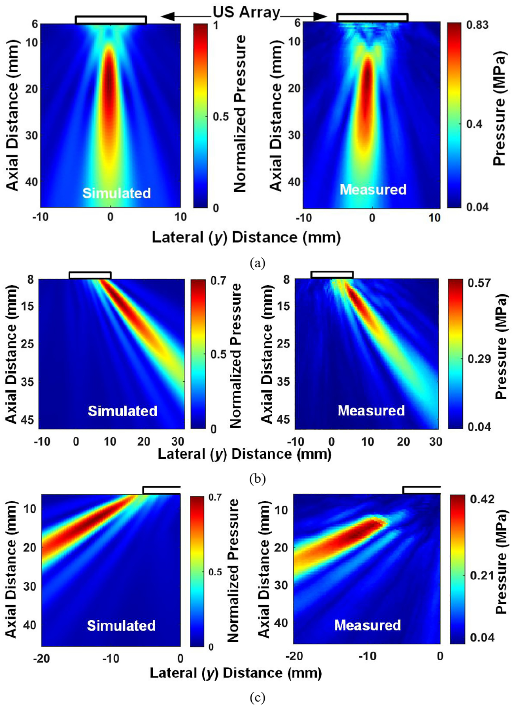
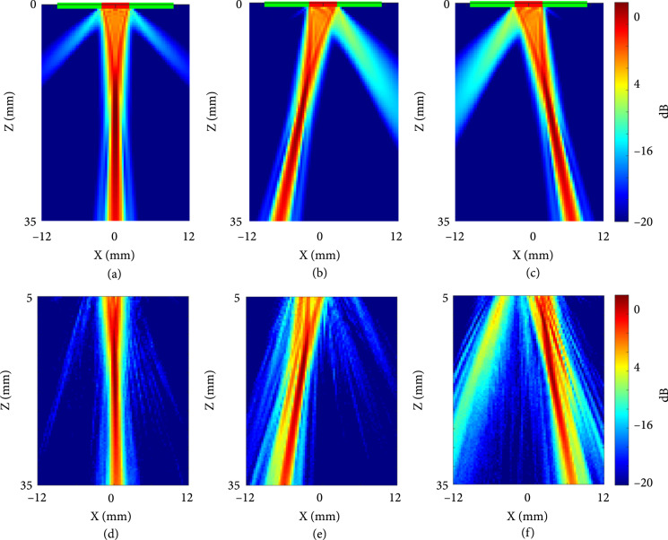
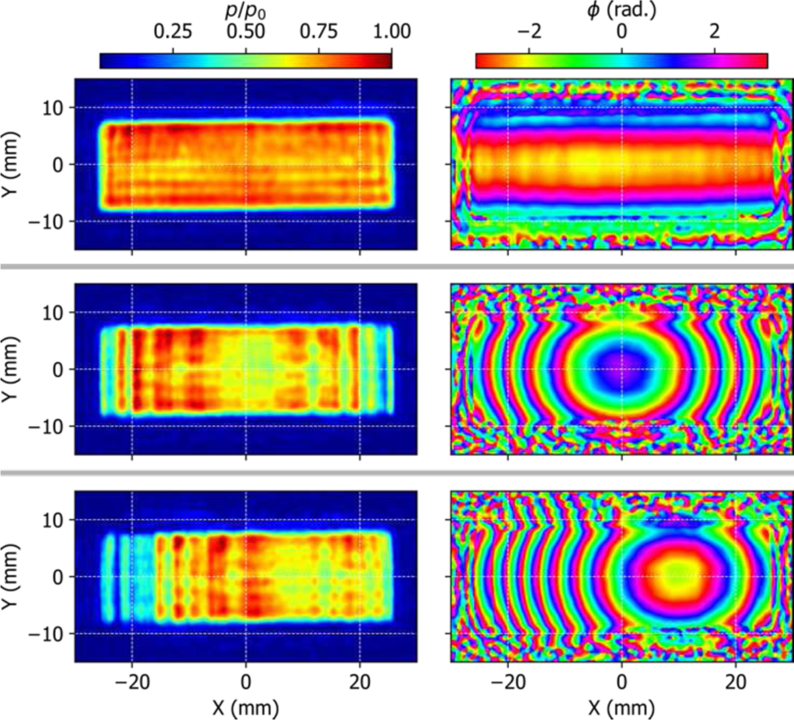
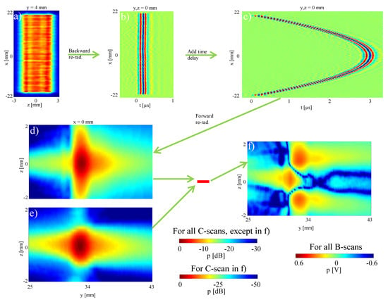

# 线阵声场建模：论文原图与本项目对照

2026-11-14。本文按“原图—硬件—算法—结论”整理，用于阅读别人如何研究线阵声场。原图文件随报告保存；图下注明作者、原图号和出处。没有重跑仿真，也没有对本探头进行测量。先前较详细的参数和其他文献见 [方法对照记录](linear_array_model_methods_comparison_2026-11-14.md)。

## 参照：我们已经算出的声场

**项目图。** 52 μm 网格，各点显示单发时间内最大绝对声压 `max_t|p|`；色标是未标定的 assumed Pa，不是水听器实测。阵元为平面矩形0.11×2.02 mm，间距0.13 mm；导出的阵元选择与延时指向20 mm。使用 k-Wave 的 BLI 阵元源、三维时域传播，均匀无损介质、无真实俯仰透镜。每活动元为同一假设源信号。[原始模型和结果](curing_sparse_comparison_2026-11-13.md)

我们得到全64与奇／偶32的**目标盒内**峰深均为18.460 mm；奇／偶组在更靠近阵面的侧方还有更高的目标盒外峰。近源峰仍有网格敏感性，不能将其认定为实测栅瓣。

## 图一：别人的三维 k-Wave 与实测声场怎么对照

**原图出处：**Z. Kashani、S. J. Ilham、M. Kiani，2022，*IEEE Transactions on Biomedical Circuits and Systems*，图13；[论文和原图说明](https://pmc.ncbi.nlm.nih.gov/articles/PMC9131469/)，DOI [10.1109/TBCAS.2022.3140591](https://doi.org/10.1109/TBCAS.2022.3140591)。图为作者稿中的原始图像，版权属于相应权利人。

**怎么看图：**每一行左图是仿真，右图是水听器测量；从上到下为0°、+45°和−45°，设定焦距20 mm。左列统一按水中0°工况峰值归一化，右列为实测 MPa，各行色标范围不同，不能只凭同一种颜色比较绝对声压。0°实测图从距离阵面约6 mm开始，不覆盖0–2 mm近场。

**硬件：**作者制作16元线阵，工作频率约1.1 MHz；在水槽中固定阵列，使用校准水听器扫描声场。该设备尺寸、频率和驱动与我们的探头不同。

**算法与模型：**用 k-Wave 三维时域计算线阵的传播；阵元使用声源掩码内的均匀分布点源。其设计模型使用61 μm网格，包含涂层、组织及衰减；图13对应水中测量及水介质仿真。COMSOL 另外用于单阵元厚度／谐振和接收器设计，不是图13阵列声场的传播求解器。

**论文结果和我们的结果：**作者报告0°时模拟与实测的轴向半功率宽度为20／18.8 mm，横向均约2 mm。我们全64在20 mm目标盒内有模型峰，但没有对应的实测；我们的声压幅值 −6 dB 宽度与此处半功率宽度定义不同，不能直接对数字。论文说明“设置相同条件后用水听器对照场形”的方法，不能验证本探头近场数值。

## 图二：约6 MHz线阵，MUST 仿真与水听器图像

**原图出处：**H. Chen 等，2022，*BME Frontiers*，图5；[论文原文](https://spj.science.org/doi/10.34133/2022/9871098)，DOI [10.34133/2022/9871098](https://doi.org/10.34133/2022/9871098)，[CC BY 4.0](https://creativecommons.org/licenses/by/4.0/)。图像来自美国国家医学图书馆开放数据集，未修改。

**怎么看图：**上排 (a)–(c) 为 MUST 仿真，下排 (d)–(f) 为水听器实测；三列分别是0°、−10°、+10°，焦点设为15 mm。图为归一化声压、dB显示；注意仿真图从 z=0 mm 开始，实测图从 z=5 mm 开始，不覆盖阵面至5 mm的声场。

**硬件：**64元透明线阵，约6 MHz；作者启用中央16元，阵元间距0.3 mm、高5 mm，利用Verasonics系统发射，校准水听器逐点扫描。其压电材料和结构不同于我们的10F。

**算法与模型：**作者用 MATLAB Ultrasound Toolbox（MUST）模拟图中的发射波束，再用水听器核验；单阵元的脉冲回波和电阻抗另外用 PiezoCAD 分析，不是图5的声场传播求解器。论文中本次未核实具体 MUST 函数、源离散和完整介质输入，不能直接推定它与我们的k-Wave同条件。

**论文结果和我们的结果：**该论文在0°时未观察到明显栅瓣，在±10°时出现较强栅瓣；我们的奇／偶32在0°设定下出现近源侧方高值，但阵元选法和图示范围不同，不能将其直接判为同一现象。两项工作都提示应同时看主瓣及目标外声场；文中没有图5的0–5 mm实测，不能证明我们的2 mm附近高值。

## 图三：真实探头的源面幅相怎么进入模型

**原图出处：**R. P. Williams 等，2023，*IEEE Transactions on Ultrasonics, Ferroelectrics, and Frequency Control*，图4；[论文和原图说明](https://pmc.ncbi.nlm.nih.gov/articles/PMC10712801/)，DOI [10.1109/TUFFC.2023.3268603](https://doi.org/10.1109/TUFFC.2023.3268603)。图为作者稿中的原始图像，版权属于相应权利人。

**怎么看图：**左列是从测量数据重建的源面相对压力幅值，右列是重建相位；上、中、下分别为无电子聚焦、轴向50 mm聚焦、50 mm聚焦并向侧方转向。上排仍有俯仰方向相位变化，对应该探头的固定透镜作用。这些是由水听器全息数据**反传重建**的源面，不是把水听器直接放在每个阵元表面的照片；相位颜色会周期折返，不能与我们的焦区切片或BLI权重作数值对照。

**硬件：**64元治疗／成像线阵，发射约1.071 MHz；固定圆柱形硅胶透镜负责俯仰聚焦，电子延时负责阵列方向聚焦。作者以水听器扫描获得声全息数据。

**算法与模型：**测量面声压经指向性和坐标校正，采用 Rayleigh 积分和角谱处理反传为源面复压力。后续将该测得源边界用于传播模型；论文还在非线性波形比较中采用单向 Westervelt 模型。作者报告特定线性工况下，重建源计算的波束峰值与水听器结果差小于3%。

**论文结果和我们的结果：**图中源面幅相并不完全均匀；我们当前给每个活动元相同的假设波形，且不含真实俯仰透镜。论文提示这两个差异可能改变真实三维声场，特别是俯仰方向；论文的3%不能写成我们模型的误差。

## 图四：只测一个平面，怎样反推并预测聚焦声场

**原图出处：**T. Marhenke 等，2019，*Sensors* 19(4), 863，图8；[论文原文](https://www.mdpi.com/1424-8220/19/4/863)，DOI [10.3390/s19040863](https://doi.org/10.3390/s19040863)，[CC BY 4.0](https://creativecommons.org/licenses/by/4.0/)。本图未修改。

**怎么看图：**(a) 是距阵面4 mm平面的实测；(b) 从该测量反传至阵面；(c) 在重建信号中加入30 mm聚焦延时；(d) 重新向前传播得到预测焦区；(e) 是另行测得的聚焦声场；(f) 为两者差异。坐标的传播方向是作者的 y，与本项目使用的 z 不同；(b)(c) 是信号／时间图，(d)(e)(f) 是空间声场图，(f) 使用独立色标。

**硬件：**商业128元 L7-4 医疗线阵，约5 MHz，水听器与定位平台用于扫描；不同于我们的64元活动孔径与探头结构。

**算法与模型：**用线性 Rayleigh–Sommerfeld 积分和时间反演，从一个平面上的测量数据重建声场，并在重建源上施加延时，预测聚焦发射。它不是k-Wave三维体网格；物理假设、测量窗口和边界条件均需单独检查。

**论文结果和我们的结果：**图中展示从“先测量、再建模”预测焦区并与实测比较的路径。我们当前从假设源出发直接计算，尚没有这一测量输入或实测对照；论文不能直接为我们的18.460 mm或近源峰背书。

## 三种方法与我们结论的对照

| 工作 | 物理声源来自 | 场如何得到 | 结果怎样核验 | 对我们目前结论的意义 |
|---|---|---|---|---|
| 本项目 | 导出几何／延时，源幅值 assumed | BLI + 三维 k-Wave | 数值回读与网格敏感性 | 得到候选场形；近源峰未充分收敛，尚非实测 |
| Kashani 图13 | 线阵设计与实物驱动 | k-Wave；图13为水中条件 | 水听器声束图 | 展示同工况场形对照，不能直接比较我们的绝对压力 |
| Chen 图5 | 透明线阵、中央16元 | MUST声束模拟 | 相同焦深和偏转角的水听器图 | 频率更相近，图中实测未覆盖0–5 mm，不能验证本项目近源峰 |
| Williams 图4 | 水听器测量后重建幅相 | 实测边界 + 传播模型 | 水听器剖面与波形 | 实际源和俯仰透镜可能改变结果，论文误差不等于我们的误差 |
| Marhenke 图8 | 一个平面的水听器数据 | Rayleigh–Sommerfeld 反传、延时、正传 | 另测聚焦场 | 展示可借鉴的实测建模链条，不能当成本探头验证 |

**目前尚未附图：**上一版讨论的 Kashani 和 Kiani 2023 图2/7/8、Karunakaran 和 Oelze 2013 图6–7/10–11，本次未取得可核验的原图文件；其文字与出处保留在 [详细方法对照](linear_array_model_methods_comparison_2026-11-14.md)。不能用本项目图或其他论文图冒充。

现阶段共同支持的判断是：**声场形态既依赖阵列选择和延时，也依赖真实源幅相、俯仰结构及介质；要验证我们的具体峰值，还需要同条件的独立计算和最终的本探头测量。** 模型中的假设压力和 `Qp` 不代表实测功率、温升或固化效果。
