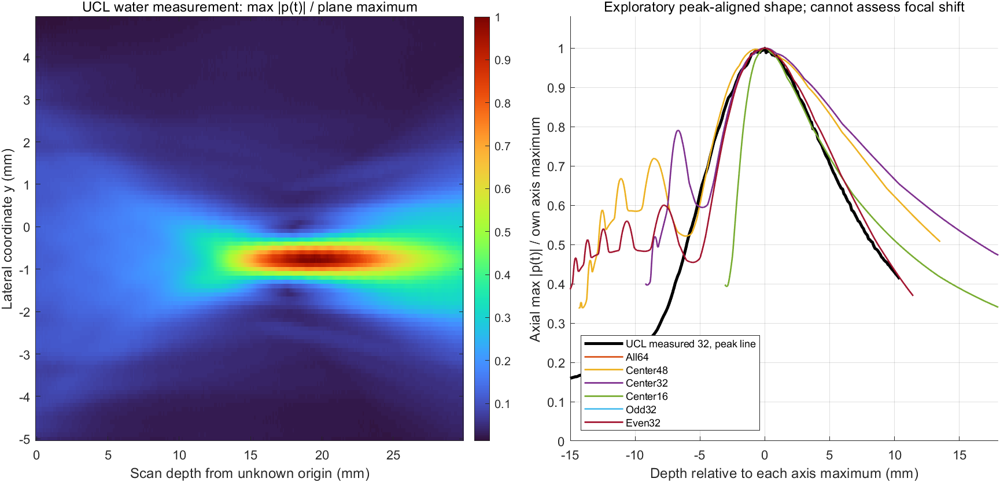

# 既有线阵声场与公开水听器原始数据对照

2026-11-14。用户将多焦点与分批照射列为待选，本次回到已有声场，比较压力分布规律。不运行声场传播、VSX或硬件。这里的外部水听器数据来自另一支探头，不是本设备的验证数据；下述“接近”仅用于明确条件下的形态比较。

## 1. 数据从哪里来

**外部原始数据。** Wang、Teoh、Jaros、Treeby 的 [公开水听器数据集](https://doi.org/10.5522/04/20005562.v1)，CC BY 4.0；对应 [2012论文](https://users.cecs.anu.edu.au/~btreeby/papers/CONF_10_2012_Wang_IEEE_UltrasoundExperiment.pdf) §II和图2–3。选 `study-3.h5` 的 `dataset1`：水中、0°、线阵方位–轴向 YZ 扫描，纸面设焦20 mm，0.1 mm扫描步长、0.4 mm水听器。文件316,450,604字节，发布 MD5 `30b161dc85d349d486aa48968af27839`；本次下载实测一致。本机文件 `independent_simulation/results/pressure_comparison_local_20261114/ucl_water_yz.h5`，不纳入 Git；另一台电脑可从 [原始数据](https://ndownloader.figshare.com/files/35609069) 和 [数据集说明及作者脚本](https://doi.org/10.5522/04/20005562.v1) 获取。

**项目原始结果。** 使用已有 52 μm 网格的 [各组轴向剖面与声场](../results/curing_field_2026-11-10/bli_gpu_full/)；这些为 k-Wave 单发线性假设模型，不是探头实测。源与分组详见 [四版](curing_four_variant_comparison_2026-11-12.md)和[奇偶](curing_sparse_comparison_2026-11-13.md)。各组 `profile_z.csv` 穿过各自目标盒峰，本次回读对应 metrics，六组均位于本项目 x=y=0；线本身横向位置一致。

| 可比条件 | Wang 水中实验 | 本项目 |
|---|---|---|
| 阵元及孔径 | 128元中的32元；间距0.3048 mm，宽0.2698 mm，跨度约9.7186 mm | 全64跨度8.30 mm；中央32跨度4.14 mm；奇／偶32跨度8.17 mm |
| 波形 | 5 MHz 短脉冲，水听器测波形 | 6 MHz、20周期名义脉冲与模型滤波 |
| 俯仰 | 6 mm高、固定俯仰焦点19 mm | 2.02 mm高，未建真实俯仰透镜 |
| 声源与介质 | 真实探头、水中传播及水听器空间平均 | 假设BLI加性源、均匀无损线性介质、网格点压力 |
| 比较目的 | 原始实验数据计算平面压力 | 假设模型的形态参考，不是同探头盲测 |

因为跨度而非数量，实验的32元**几何尺度更接近本项目全64**，同时也保留中央32作为同阵元数对照；两组都不能视为同硬件。论文另一个 XY 横截面实验设焦21.3 mm，不能混作本次 YZ 扫描的20 mm设定。

## 2. 图表：原始波形换算后与我们的压力分布



**左图：**从UCL原始逐点时间波形计算 `max_t|p(t)|` 后，用二维扫描面的最大值归一化。纵轴为作者数据 Y（方位），横轴为 Z 相对于**扫描起点**的距离；扫描起点到探头表面的实际距离没有在此数据中给出。数据集的方向 X 是俯仰、Y 是阵列方位，与本项目横向 x 的名称不同。颜色表示压力幅值比例，不是目标外声能或热量。

**右图：**只为观察形状，将每条曲线各自的峰值平移至0 mm并归一化；黑线为穿过UCL扫描平面最大值的固定横向位置，彩线为本项目各组中心轴。**这种平移强制峰值重合，不能用来检验焦点是否在20 mm、实际峰位偏差或做定量通过判定。**UCL峰位置按数据坐标是 Y=−0.8 mm、Z=19.5 mm；后者相对扫描起点，不是距探头19.5 mm。选峰所在横线是事后选择，不能自动称作经过校准的换能器轴线。为复核，同一CSV也保存 Y=0 线：它在 Z=19.5 mm 处约为平面峰的10.9%，本身最大值位于另一深度，表明不能将坐标零线当成相同的声束中心。

处理脚本 [pressure_ucl_compare_20261114.m](../pressure_ucl_compare_20261114.m) 使用数据集作者脚本相同的0°数据与5 MHz标量灵敏度，将电压除以 `6.7000002e−8 V/Pa`，分别提取每点峰值绝对声压、峰正压、峰负压；没有进行频率响应反卷积。作者论文图3的 total 是频谱幅值积分，不能与 `max_t|p|` 当成同一个量。压缩后的 [UCL计算压力平面](../results/pressure_evidence_20261114/ucl_pressure_maps.mat)、[轴线表](../results/pressure_evidence_20261114/ucl_axis_profiles.csv)、[项目轴峰表](../results/pressure_evidence_20261114/project_axis_peaks.csv)、[对齐采样表](../results/pressure_evidence_20261114/exploratory_peak_aligned_samples.csv)随仓库同步；源波形留本机。

### 峰值对齐后的几处数值

各条曲线独立按自己的峰值归一化；位置是**相对各自峰值**，不是距探头绝对深度。位置不在已有曲线区间时写“未覆盖”。这是形态示例，不是预先定义的合格标准。

| 曲线 | 峰前5 mm | 峰值 | 峰后5 mm | 峰后10 mm |
|---|---:|---:|---:|---:|
| UCL实测，过扫描面峰值的线 | 0.629 | 1.000 | 0.706 | 0.429 |
| 全64 | 0.466 | 1.000 | 0.741 | 0.435 |
| 中央48 | 0.603 | 1.000 | 0.833 | 0.623 |
| 中央32 | 0.596 | 1.000 | 0.850 | 0.666 |
| 中央16 | 未覆盖 | 1.000 | 0.721 | 0.511 |
| 奇／偶32 | 约0.466 | 1.000 | 约0.741 | 约0.435 |

**实际观察。** 各线在所选峰值附近都形成主要高值区，峰后下降；全64和奇／偶32在所列峰后两个位置与该条实测线比较接近，但峰前5 mm为0.466对0.629，存在明显差异。中央48、32在所列峰后位置下降更慢。**只用三个位置不能断言整条曲线贴合，更不能因此给模型排名或确定哪种阵元数正确。**奇／偶与全64的轴向归一化曲线接近，也与本项目线性对称及分组源叠加特性有关，并非新的实物验证。

## 3. 哪些规律得到支持，哪些还不能判断

| 问题 | 当前证据 | 判断 |
|---|---|---|
| 聚焦线阵的轴向存在高值区、之后降低 | 同口径水听器波形提取与项目轴向曲线都出现 | **定性相符**；不意味着分布处处相同 |
| 我们全64的后焦轴向形状是否有类似实例 | 峰值对齐后，+5/+10 mm两个采样点接近 | **有限支持**；峰前有差异，且这是事后对齐和不同探头 |
| 设20 mm后实际峰是否在20 mm | UCL YZ扫描的深度起点相对探头面未知；对齐图抹除了峰深 | **无法判断** |
| 连续孔径越小焦点是否偏浅 | UCL只有一个活动孔径，且与我们透镜和脉冲不同 | **不能验证因果趋势** |
| 奇偶组在约2 mm处的侧方高值 | UCL为另一个连续阵列；二维扫描绝对深度未标定 | **无法验证位置或机制** |
| 三维目标外最大值、泄露及固化 | 外部只有该二维扫描面；本项目未标定 | **不能判断** |

水听器接收孔径0.4 mm会对瞬时声压做空间平均，不能在 `max_t|p|` 图上简单模糊后声称已消除其影响。论文是短脉冲，传播中有非线性；本项目是20周期线性无损模型。固定俯仰透镜也会改变轴向分布。仅凭上述部分定性相似，**不能判定模型整体已验证，也不能把声压结果当作温升、固化或安全结论**。

## 4. 本次执行与检查

MATLAB R2024a Update 9 只读取现有 CSV 和外部HDF5、统计和绘图；命令（项目根目录）：

```powershell
matlab -batch "run('independent_simulation/pressure_ucl_compare_20261114.m')"
```

已核对数据大小和MD5，按作者脚本使用 `scanSize` 重排和灵敏度，确认扫描范围 Y=−5.0…4.9 mm、Z=0…29.9 mm（扫描起点坐标）；测量面最大值非横向或轴向扫描边界。`peak_abs`、`peak_pos`、`peak_neg`分开保存，避免把论文图的频谱指标当成时域峰值。运行期间曾发现标称 Y=0 线未经过平面峰，已在最终脚本保留零线并另外明确报告峰所在横线；没有把峰值对齐曲线用于焦深验证。方法由 Astra提出比较边界，Sol独立审查相关数据和曲线口径。
# 2026-11-14 补充：四组分图

原图中 All64、Odd32、Even32 归一化轴线近乎重合，后绘制的曲线遮挡前面的曲线。新增[四组分图](../results/pressure_evidence_20261114/ucl_four_selected_profiles.png)，各图分别比较 UCL 与 All64、Center48、Center32、Odd32，统一坐标和归一化口径。读取已有 CSV，不重新求解；生成脚本为 [plot_pressure_four_groups_20261114.m](../plot_pressure_four_groups_20261114.m)。All64 与 Odd32 对应采样点归一化最大差约 3.16e-6；仅为轴线结果，不代表离轴声场相同。图中模型剖面限制在 z=2–29.9 mm，Center32 峰在 z=11.232 mm，不是 20 mm 目标附近的独立峰；对齐峰值无法比较实际焦点距离。UCL 与模型的探头及脉冲不同，不能据相似形状认定验证成功。
