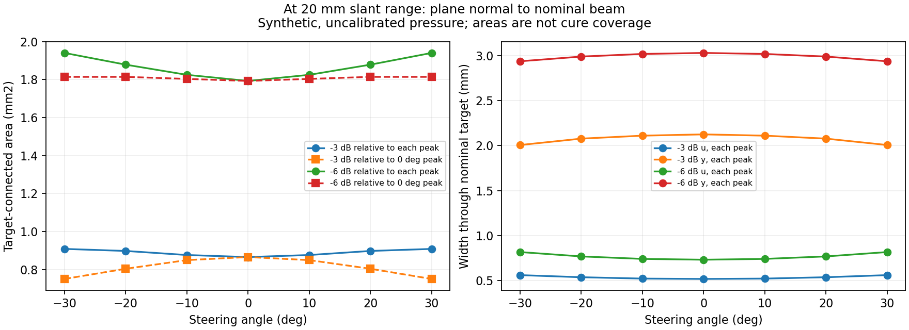

# 全64元固定20 mm距离的偏转聚焦与焦区范围

开始日期：2026-11-19；续算与最终核验：2026-11-20。**已完成0/±10/±20/±30°七组52 μm离线单发声场、统一范围分析及原始输出回读。** 无VSX或硬件操作；以下均为未标定模型结果。

## 问题与定义

研究探头姿态固定时，平面内电子偏转对声压集中范围的影响；不把小焦区自动当成更优，目标覆盖、允许峰位误差和固化要求尚未给出。

原点为阵面中心，阵元沿x，法线+z；θ相对+z，目标 `F=[20 sinθ,0,20 cosθ] mm`，中心至目标直线距离固定20 mm，不是z恒为20 mm。先研究x-z平面内偏转；一维阵列不具备同等的俯仰独立控制能力。

本轮每工况仅模拟一发原6 MHz/20周期波形，不模拟原序列300脉冲的累计照射。分析 `max_t|p|`，各空间点的峰值可能来自不同时刻，不是同一瞬间快照。压力单位为assumed Pa，源几何来自已有代码且 `existing_code_unverified`，目标为synthetic。均匀线性无损流体、声速1540 m/s、密度1000 kg/m³、每元1 Pa assumed、全部64元同幅；没有真实俯仰透镜、组织/血液异质性或声输出标定。

### 焦区范围的指标口径

- 在目标中心半径5 mm球与物理域、z≥2 mm的交集中寻找局部峰；局部峰落在找峰或物理边界时标为无效。这里的5 mm球受有限y域裁切，不代表完整球邻域均已采样。
- 压力−6/−3 dB分别为本组局部峰×`10^(−6/20)`和×`10^(−3/20)`。三维范围为包含局部峰的六邻域连通分量，体积=体素数×dx×dy×dz；同时报告整个连通区的投影跨度、以及穿过峰值沿声束n、平面内垂直方向u、俯仰y的首次阈值交点宽度。连通区并不一定是椭球，可能包含焦前相连的高值区域；不能用三条宽度简单相乘代替体积。
- 实际目标位置F处，构造人为垂直于名义声束的u-y截面，提取包含目标中心的四邻域超阈值分量面积及穿过目标的u/y宽度。它不是左心耳真实表面，也不是已验证固化面积。
- 同时补充以0°局部峰为固定参考的共同绝对声压阈值，区分归一化形状变化与实际幅值降低。没有材料阈值时，两个声压范围都不能直接称为固化区。
- 目标点及旋转剖面均从峰值场作空间线性插值；与历史最近格点20.020 mm取值口径不同。任一分量触边、剖面不闭合均明确标记，不能报告为完整范围。

## 七角度结果

### 20 mm名义目标截面范围（首要比较）

截面垂直于名义声束，通过指定F；压力−6 dB阈值相对各组局部峰。宽度通过目标中心；面积统计目标所在连通分量，不假设椭圆。

| 角度 | 面积 mm² | 平面内横向u宽 mm | 俯仰y宽 mm | 目标声压/0° |
|---:|---:|---:|---:|---:|
| 0° | 1.7932 | 0.7325 | 3.0292 | 100.00% |
| +10° | 1.8254 | 0.7415 | 3.0180 | 98.84% |
| −10° | 1.8254 | 0.7415 | 3.0180 | 98.84% |
| +20° | 1.8790 | 0.7691 | 2.9887 | 96.30% |
| −20° | 1.8790 | 0.7691 | 2.9888 | 96.31% |
| +30° | 1.9406 | 0.8175 | 2.9366 | 92.81% |
| −30° | 1.9406 | 0.8175 | 2.9367 | 92.81% |

本档模型中，0°→±30°时截面主要在u方向变宽，y方向略缩小；相对峰压的−6 dB面积约增8.22%，同时目标点压力下降。没有覆盖要求或材料阈值时，不能将该变化直接排序为更好或更差。表内插值小数用于复核，不表示实物毫米级精度。

### 实际压力峰处的宽度与三维连通区（补充）

| 角度 | 20 mm目标截面−6 dB面积 mm² | 固定0°−6 dB阈值面积 mm² | 峰值处n/u/y的−6 dB宽度 mm | 3D−6 dB连通体积 mm³ | 目标声压/0° |
|---:|---:|---:|---|---:|---:|
| 0° | 1.7932 | 1.7932 | 13.4185 / 0.7154 / 2.8861 | 30.1725 | 100.00% |
| +10° | 1.8254 | 1.8039 | 13.7476 / 0.7224 / 2.8408 | 31.3817 | 98.84% |
| −10° | 1.8254 | 1.8039 | 13.7478 / 0.7224 / 2.8408 | 31.3815 | 98.84% |
| +20° | 1.8790 | 1.8146 | 14.6174 / 0.7458 / 2.7835 | 35.3286 | 96.30% |
| −20° | 1.8790 | 1.8146 | 14.6176 / 0.7458 / 2.7836 | 35.3289 | 96.31% |
| +30° | 1.9406 | 1.8146 | 23.9864 / 0.7867 / 2.6861 | 40.9704 | 92.81% |
| −30° | 1.9406 | 1.8146 | 23.9866 / 0.7867 / 2.6861 | 40.9713 | 92.81% |

七组−3/−6 dB连通区、目标截面及所用剖面均未检出触边或未闭合状态；这只排除了本次检测到的截断，不证明域外声场、网格收敛或实物能力。±10°相对自身峰的目标截面积约增1.79%，共同绝对阈值面积约增0.60%；±20°分别约增4.78%与1.20%；±30°约增8.22%与1.20%。正负10/20/30°公共坐标声压镜像相对L2约0.00359%/0.00400%/0.00397%。

### 阈值对范围解释的影响

偏转后相对峰压范围扩大，并不意味着相同高声压水平的目标覆盖扩大。0°→+30°时，目标截面相对本组峰的−3 dB面积约0.8658→0.9087 mm²，但以0°峰为固定参考的−3 dB面积约0.8658→0.7505 mm²。目标点压力下降，降低归一化阈值会把更多区域纳入，两个口径必须分开。

同样，+30°相对本组峰的−6 dB纵向穿峰宽约23.986 mm，−3 dB约10.080 mm；以0°固定−6 dB阈值计算约17.513 mm。该变化与较低阈值下焦前高值区域的连通有关，不能只用23.986 mm概括所有“焦点长度”。本报告保留两档阈值和共同阈值，不将任何一项直接作为固化尺寸。

### 名义目标与实际压力峰

范围与峰位分别报告。下表列正角模型结果，负角完整坐标见CSV；20 mm是几何设计距离，不是已经实现的压力峰距离。

| 角度 | 名义目标x/z mm | 实际压力峰x/z mm | 峰与目标三维距离 mm |
|---:|---|---|---:|
| 0° | 0.000 / 20.000 | 0.000 / 18.460 | 1.540 |
| +10° | 3.473 / 19.696 | 3.172 / 17.888 | 1.833 |
| +20° | 6.840 / 18.794 | 6.136 / 16.744 | 2.168 |
| +30° | 10.000 / 17.321 | 8.684 / 14.924 | 2.734 |

因此，目标截面的范围取自指定F处，而穿峰宽度取自实际压力峰处；两者不是同一个平面。该模型中的峰位提前不能直接作为实物定位误差，也不能据此给出未经验证的延时补偿值。

结果表：[完整CSV](../results/steered_focus_2026-11-19/common_y6p24/analysis/summary.csv)，阈值、坐标、宽度、边界状态及输入哈希详见[分析清单](../results/steered_focus_2026-11-19/common_y6p24/analysis/analysis_manifest.json)。最终图包含全部七个角度。

图中的等值线是标量阈值线，可能包含与目标或局部峰不连通的区域；表格仅统计指定连通分量。

## 计算域、求解器及验证

本机MATLAB R2024b Update2、RTX4070 Laptop8GB、RAM约16GB。k-Wave MATLAB工具箱来自本机1.4.1目录，记录实际路径和 `kWaveGrid.m` 哈希；社区 `kspacefirstorder-unified v1.4.2` 发布包中的CUDA v1.3 build3.6二进制SHA256为 `806f20c2529c2454cef89badbfcc9c19c2360260236af5a4e98735a336899b09`，与历史结果相同。本机CUDA路径 `H:/HDSP/tools/kwave_unified_1p4p2` 不保证跨电脑可用。

首次31.2×10.4×31.2 mm共同域0°在CUDA缓冲区初始化时内存不足，输出不完整，保留失败日志，不纳入结果。实际共同域为31.2×6.24×31.2 mm、52 μm（600×120×600物理格点）、1.04 mm外部PML（20格，扩展后640×160×640）、CFL0.2。源平面z=0、物理轴向约−0.52至30.628 mm。缩小俯仰域以适配内存，因此必须逐组检查焦区边界，也不能保证域外没有高值。

七组均Nt=5925、dt≈6.75325 ns、总时窗约40.006 μs；适配器按最新源延时、波形尾部和最远传播界确保时窗不短于既有保守设置。末帧相对峰很小只作为明显截时检查，不能独立证明时间窗收敛。

实际完成的检查：

- 七角目标距离、延时到时、正负角镜像、0°旧延时和目标元数据检查通过；五个不一致元数据输入在分配网格前被拒绝。
- 既有BLI回归8/8，旧焦深输入测试通过；Python解析高斯、旋转宽度/面积、连通性、截断、公共阈值和HDF5转轴测试13/13通过。Code Analyzer有10条日期函数/多余抑制标记建议，未声称零消息。
- 七组原始CUDA HDF5峰压、RMS重算Qp及末帧与保存MAT逐项数值一致，网格、时间、介质、PML、9275点源支撑及求解器哈希一致，见[回读表](../results/steered_focus_2026-11-19/common_y6p24/raw_readback.csv)和[检查汇总](../results/steered_focus_2026-11-19/common_y6p24/verification_summary.json)。最终分析脚本及回读脚本哈希均随清单记录。
- 新域0°与旧52 μm轴线在z≥2 mm共同范围的相对L2约0.030224%，最大绝对差约0.002063 assumed Pa。只核对轴线；旧大场本机是LFS指针，没有本轮全三维新旧域对照。

输入来自原保存All64 MAT，经独立几何延时更新，仅供仿真；没有导出或执行新的硬件序列。指定手册版本、TX坐标与延时语义见[前期研究说明](all64_steered_focus_research_2026-11-19.md)中的D00163 Rev.K附录A172–A176；编程语义不构成探头偏转能力标定。

### +30°完整原始输出的恢复

2026-11-20继续任务时，+30°原CUDA输出已于11月19日写完，但MATLAB整理未结束，stage仍停在运行，已无活动进程。HDF5包含`t_index=Nt=5925`、完整后处理及总耗时属性，所需数组有限且RMS不超过峰压，见[原始完成证据](../results/steered_focus_2026-11-19/common_y6p24/angle_p30_dx52_gpu_io/raw_completion_audit_20261120.json)。

[恢复转换](../curing_steered_focus_recover_20261120.m)先在既有+20°上验证峰压/Qp/末帧/坐标逐项相等，再恢复+30°MAT并通过独立回读，没有重算+30°传播，见[恢复验证记录](../results/steered_focus_2026-11-19/recovery_validation_20261120.json)。原stage快照保留，恢复时间与原CUDA耗时分开记录；流式日志末尾不完整，未声称恢复原MATLAB退出码。−30°随后通过Windows入口完成，MATLAB退出码为0。

## 复现与数据边界

MATLAB入口：[GPU单组运行](../curing_steered_focus_gpu_20261119.m)，Python：[焦区分析](../analyze_steered_focus_20261119.py)、[原始输出回读](../verify_steered_focus_20261119.py)。实施步骤与本机资源调整见[计划](plans/2026-11-19-steered-focus-simulation.md)。

11月19日传播启动实际使用明确指定R2024b的batch命令；11月20日−30°通过[Windows入口](../run_R2024b.ps1)的 `-Task steered-focus -Angles -30` 执行。`-Task steered-focus-validate` 的输入及目录隔离检查已实际通过，默认演示行为保留。旧版[入口验证](../results/steered_focus_2026-11-19/windows_matlab_validation.json)与本次[验证日志](../results/steered_focus_2026-11-19/windows_matlab_validation_20261120.txt)均保留。

另一台电脑拉取后，既有日志目录也受防覆盖保护。要重算，应使用新的安全运行标签，例如 `./run_R2024b.ps1 -Task steered-focus -RunTag rerun_20261120 -Angles 0,10,-10,20,-20,30,-30`，输出到 `common_y6p24/rerun_20261120/`，不会清理或覆盖旧记录；分析和回读脚本的输入目录相应指向该子目录。省略标签时保持原路径，已有结果会拒绝覆盖。没有修改系统代理、许可文件或用户MATLAB会话；初始许可错误5201经用户手动启动后恢复。

三维MAT与CUDA HDF5体积较大，仅本机保存，Git同步代码、小型输入、日志、表图和验证清单。另一台电脑需要复制大场或重新计算，并准备MATLAB、k-Wave及CUDA依赖。全部数据未标定、无真实俯仰透镜、单档网格且近源敏感性未消除；无实测声压、温升、固化或临床安全结论。
