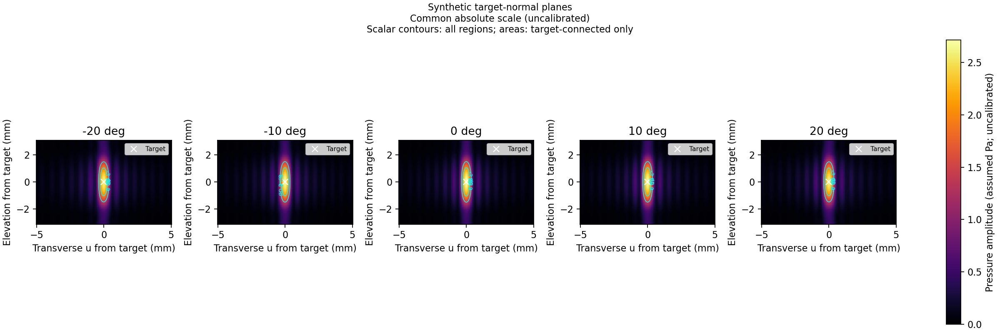
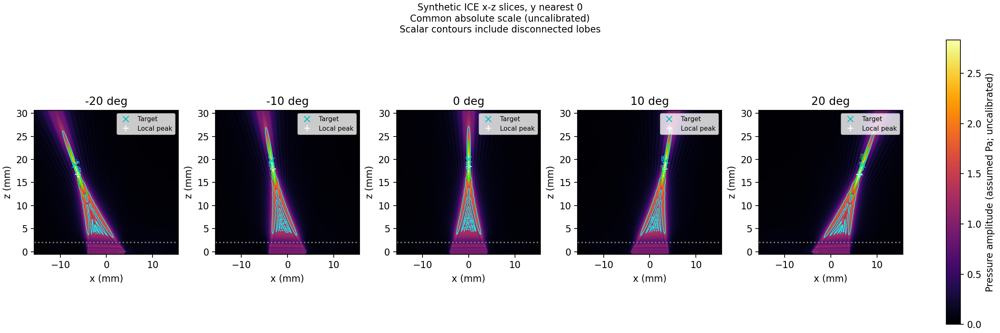

# 全64元固定20 mm距离的偏转聚焦与焦区范围

日期：2026-11-19。**执行中：目前0°、±10°和±20°完成，完整七角度比较尚未完成。** 用户已确认继续使用52 μm完成0/±10/±20/±30°。无VSX或硬件操作。

## 问题与定义

研究探头姿态固定时，平面内电子偏转对声压集中范围的影响；不把小焦区自动当成更优，目标覆盖、允许峰位误差和固化要求尚未给出。

原点为阵面中心，阵元沿x，法线+z；θ相对+z，目标 `F=[20 sinθ,0,20 cosθ] mm`，中心至目标直线距离固定20 mm，不是z恒为20 mm。先研究x-z平面内偏转；一维阵列不具备同等的俯仰独立控制能力。

本轮每工况仅模拟一发原6 MHz/20周期波形，不模拟原序列300脉冲的累计照射。分析 `max_t|p|`，各空间点的峰值可能来自不同时刻，不是同一瞬间快照。压力单位为assumed Pa，源几何来自已有代码且 `existing_code_unverified`，目标为synthetic。均匀线性无损流体、声速1540 m/s、密度1000 kg/m³、每元1 Pa assumed、全部64元同幅；没有真实俯仰透镜、组织/血液异质性或声输出标定。

### 焦区范围的指标口径

- 在目标中心半径5 mm球与物理域、z≥2 mm的交集中寻找局部峰；局部峰落在找峰或物理边界时标为无效。这里的5 mm球受有限y域裁切，不代表完整球邻域均已采样。
- 压力−6/−3 dB分别为本组局部峰×`10^(−6/20)`和×`10^(−3/20)`。三维范围为包含局部峰的六邻域连通分量，体积=体素数×dx×dy×dz；同时报告整个连通区的投影跨度、以及穿过峰值沿声束n、平面内垂直方向u、俯仰y的首次阈值交点宽度。连通区并不一定是椭球，可能包含焦前相连的高值区域；不能用三条宽度简单相乘代替体积。
- 实际目标位置F处，构造人为垂直于名义声束的u-y截面，提取包含目标中心的四邻域超阈值分量面积及穿过目标的u/y宽度。它不是左心耳真实表面，也不是已验证固化面积。
- 同时补充以0°局部峰为固定参考的共同绝对声压阈值，区分归一化形状变化与实际幅值降低。没有材料阈值时，两个声压范围都不能直接称为固化区。
- 目标点及旋转剖面均从峰值场作空间线性插值；与历史最近格点20.020 mm取值口径不同。任一分量触边、剖面不闭合均明确标记，不能报告为完整范围。

## 目前已完成的结果

| 角度 | 20 mm目标截面−6 dB面积 mm² | 固定0°−6 dB阈值面积 mm² | 峰值处n/u/y的−6 dB宽度 mm | 3D−6 dB连通体积 mm³ | 目标声压/0° |
|---:|---:|---:|---|---:|---:|
| 0° | 1.7932 | 1.7932 | 13.4185 / 0.7154 / 2.8861 | 30.1725 | 100.00% |
| +10° | 1.8254 | 1.8039 | 13.7476 / 0.7224 / 2.8408 | 31.3817 | 98.84% |
| −10° | 1.8254 | 1.8039 | 13.7478 / 0.7224 / 2.8408 | 31.3815 | 98.84% |
| +20° | 1.8790 | 1.8146 | 14.6174 / 0.7458 / 2.7835 | 35.3286 | 96.30% |
| −20° | 1.8790 | 1.8146 | 14.6176 / 0.7458 / 2.7836 | 35.3289 | 96.31% |

这五组当前所列−6 dB连通区和目标截面均未触边。±10°相对自身峰的目标截面积约增1.79%，共同绝对阈值面积约增0.60%；±20°分别约增4.78%与1.20%。正负10/20°声压镜像相对L2约0.00359%/0.00400%。只描述本档假设模型的结果，不判定实物可用角度。±30°仍在计算。

结果表：[完整CSV](../results/steered_focus_2026-11-19/common_y6p24/analysis/summary.csv)，阈值、坐标、宽度、边界状态及输入哈希详见[分析清单](../results/steered_focus_2026-11-19/common_y6p24/analysis/analysis_manifest.json)。图随已完成工况更新，不能把当前图中缺失的角度理解为零值。

图中的等值线是标量阈值线，可能包含与目标或局部峰不连通的区域；表格仅统计指定连通分量。

## 计算域、求解器及验证

本机MATLAB R2024b Update2、RTX4070 Laptop8GB、RAM约16GB。k-Wave MATLAB工具箱来自本机1.4.1目录，记录实际路径和 `kWaveGrid.m` 哈希；社区 `kspacefirstorder-unified v1.4.2` 发布包中的CUDA v1.3 build3.6二进制SHA256为 `806f20c2529c2454cef89badbfcc9c19c2360260236af5a4e98735a336899b09`，与历史结果相同。本机CUDA路径 `H:/HDSP/tools/kwave_unified_1p4p2` 不保证跨电脑可用。

首次31.2×10.4×31.2 mm共同域0°在CUDA缓冲区初始化时内存不足，输出不完整，保留失败日志，不纳入结果。实际共同域为31.2×6.24×31.2 mm、52 μm（600×120×600物理格点）、1.04 mm外部PML（20格，扩展后640×160×640）、CFL0.2。源平面z=0、物理轴向约−0.52至30.628 mm。缩小俯仰域以适配内存，因此必须逐组检查焦区边界，也不能保证域外没有高值。

0°目前Nt=5925、dt≈6.75325 ns、总时窗约40.006 μs；适配器按最新源延时、波形尾部和最远传播界确保时窗不短于既有保守设置。末帧相对峰很小只作为明显截时检查，不能独立证明时间窗收敛。

实际完成的检查：

- 七角目标距离、延时到时、正负角镜像、0°旧延时和目标元数据检查通过；五个不一致元数据输入在分配网格前被拒绝。
- 既有BLI回归8/8，旧焦深输入测试通过；Python解析高斯、旋转宽度/面积、连通性、截断、公共阈值和HDF5转轴测试13/13通过。Code Analyzer有10条日期函数/多余抑制标记建议，未声称零消息。
- 当前0°及±10/±20°原始CUDA HDF5峰压、RMS重算Qp及末帧与保存MAT逐项数值一致，见[回读表](../results/steered_focus_2026-11-19/common_y6p24/raw_readback.csv)和[检查汇总](../results/steered_focus_2026-11-19/common_y6p24/verification_summary.json)。
- 新域0°与旧52 μm轴线在z≥2 mm共同范围的相对L2约0.030224%，最大绝对差约0.002063 assumed Pa。只核对轴线；旧大场本机是LFS指针，没有本轮全三维新旧域对照。

输入来自原保存All64 MAT，经独立几何延时更新，仅供仿真；没有导出或执行新的硬件序列。指定手册版本、TX坐标与延时语义见[前期研究说明](all64_steered_focus_research_2026-11-19.md)中的D00163 Rev.K附录A172–A176；编程语义不构成探头偏转能力标定。

## 复现与数据边界

MATLAB入口：[GPU单组运行](../curing_steered_focus_gpu_20261119.m)，Python：[焦区分析](../analyze_steered_focus_20261119.py)、[原始输出回读](../verify_steered_focus_20261119.py)。实施步骤与本机资源调整见[计划](plans/2026-11-19-steered-focus-simulation.md)。

本轮传播启动实际使用明确指定R2024b的batch命令；[Windows入口](../run_R2024b.ps1)新增 `-Task steered-focus` 和 `-Task steered-focus-validate`，默认演示行为保留。PowerShell解析、五项无效输入拒绝检查以及实际 `-Task steered-focus-validate` MATLAB执行均通过，见[入口验证](../results/steered_focus_2026-11-19/windows_matlab_validation.json)。传播任务分支尚未通过此PowerShell入口完整重跑，避免重复计算。示例：`./run_R2024b.ps1 -Task steered-focus -Angles 0,10,-10,20,-20,30,-30`；已有结果会拒绝覆盖，勿再次运行已完成工况。没有修改系统代理、许可文件或用户MATLAB会话；初始许可错误5201经用户手动启动后恢复。

三维MAT与CUDA HDF5体积较大，仅本机保存，Git同步代码、小型输入、日志、表图和验证清单。另一台电脑需要复制大场或重新计算，并准备MATLAB、k-Wave及CUDA依赖。全部数据未标定、无真实俯仰透镜、单档网格且近源敏感性未消除；无实测声压、温升、固化或临床安全结论。
